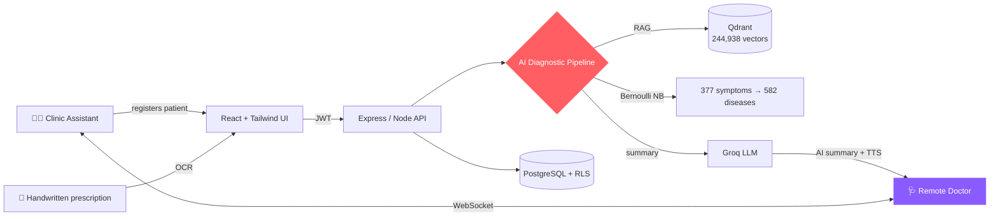

<!-- Replace every PriyamMishra853 with your GitHub username -->


<table>
<tr>
<td width="42%" align="center">

</td>
<td width="58%">

<a href="https://git.io/typing-svg"></a>

🎓 **B.Tech CSE** @ UIET, CSJM University Kanpur ('29)<br/>
🚀 Team lead on **RuralAI**, an AI virtual clinic for rural healthcare<br/>
🧠 Into **RAG, LLMs, system design** and scalable backends<br/>
🤖 Core member, **Vortex Robotics Club**<br/>
📍 Kanpur, India

<a href="https://www.linkedin.com/in/priyam-mishra-331177339/"></a>
<a href="mailto:xyzmishra220@gmail.com"></a>
<a href="https://github.com/PriyamMishra853"></a>

</td>
</tr>
</table>

## 👀 Who's Visiting?

<table>
<tr>
<td align="center" width="33%"><h2>🚀</h2><b>Founder / Startup</b></td>
<td align="center" width="33%"><h2>🧑‍💼</h2><b>Recruiter</b></td>
<td align="center" width="33%"><h2>👨‍💻</h2><b>Fellow Developer</b></td>
</tr>
<tr>
<td valign="top">

<details><summary><b>Why bet on me →</b></summary>

- Lead a 4-person team that shipped an **AI clinic** end-to-end
- Go from 0 to winning demo in **24h** (🥇 IBM Bob)
- Comfortable across **frontend, backend, RAG and infra**
- Already pitched to a **Governor**, so I can pitch to your users too

<a href="mailto:xyzmishra220@gmail.com?subject=Startup%20opportunity%20for%20Priyam"></a>
</details>

</td>
<td valign="top">

<details><summary><b>The 10-second scan →</b></summary>

- 🎓 B.Tech CSE '29 · **CGPA 8.64**
- 🥇 1st IBM Bob · 🥉 3rd IIT BHU Technex
- 🧩 **200+** DSA problems solved
- 🛠️ React · Node · Python · C++ · SQL · Docker

<a href="mailto:xyzmishra220@gmail.com?subject=Internship%20opportunity%20for%20Priyam"></a>
</details>

</td>
<td valign="top">

<details><summary><b>Let's collaborate →</b></summary>

- Into **RAG, vector DBs, LLM apps** and system design
- Happy to pair on hackathons and open source
- Swap notes on DSA, or on M5 dev setups 🍏

<a href="https://github.com/PriyamMishra853?tab=repositories"></a>
</details>

</td>
</tr>
</table>

## 💻 Currently Booting Up

<p align="center"></p>

<p align="center">


</p>

## 🧬 CS Core

<p align="center">


</p>

```cpp
class Priyam : public Engineer {
    vector<string> builds   = {"RuralAI", "Election Mgmt System", "VectorDB"};
    string         motto    = "AI assists, doctor decides.";
    bool           hireable = true;   // startups, let's talk 🚀
};
```

## 🏆 Hall of Fame

<table>
<tr>
<td align="center" width="25%"><h1>🥇</h1><b>1st Place</b><br/><sub>IBM Bob Hackathon 2026</sub></td>
<td align="center" width="25%"><h1>🎤</h1><b>AI Manthan 2.0</b><br/><sub>Presented RuralAI to the Governor of Uttar Pradesh</sub></td>
<td align="center" width="25%"><h1>🥉</h1><b>3rd Place</b><br/><sub>Botstacle, IIT BHU Technex '26</sub></td>
<td align="center" width="25%"><h1>🥈</h1><b>2nd Place</b><br/><sub>District-level Debate</sub></td>
</tr>
<tr>
<td align="center"><h1>💯</h1><b>100 / 100</b><br/><sub>Class 12 Computer Science Boards</sub></td>
<td align="center"><h1>🧩</h1><b>200+</b><br/><sub>DSA problems (LeetCode + GfG)</sub></td>
<td align="center"><h1>🎯</h1><b>97.4%</b><br/><sub>Top-5 diagnostic accuracy in RuralAI</sub></td>
<td align="center"><h1>⏱️</h1><b>70–80% faster</b><br/><sub>School elections, now paperless</sub></td>
</tr>
</table>

## 🗺️ The Journey So Far

<p align="center"></p>

## 🚀 Featured Projects

### 🥇 [IBM Bob Hackathon 2026: Winning Build](https://github.com/PriyamMishra853/IBMBOB26-24hHackathonProduct-) &nbsp; `1st Place`
- Built and shipped in **24 hours**, taking **1st place** at IBM Bob Hackathon 2026

### 🩺 [RuralAI: AI Virtual Clinic](https://github.com/PriyamMishra853/RURALAI-) &nbsp; `Team Lead`
> *"AI assists, doctor decides."* A clinic assistant registers patients and a remote doctor reviews AI-generated summaries.

- **RAG + Bernoulli Naive Bayes** pipeline on **Qdrant**, with Groq LLMs
- **244,938 vectors** · **377 symptoms** · **582 diseases** · **97.4% Top-5 accuracy**
- OCR for handwritten prescriptions, TTS, JWT, PostgreSQL RLS, live WebSockets
- **50,000+ tests**, deployed on Vercel + Railway

<details>
<summary><b>🏗️ Peek at the architecture</b></summary>



</details>

     

### 🗳️ [Election Management System](https://github.com/PriyamMishra853/ElectionManagementSystem-) &nbsp; `Solo Developer`
- Moved Class 12 school elections fully online: **0 paper ballots**, **100% accurate automated counting**
- Voter registration, candidate management, secure voting, PDF result reports

  

### 🧪 More Builds

<p align="center">
<a href="https://github.com/PriyamMishra853/VectorDB-"></a>
<a href="https://github.com/PriyamMishra853/SIH2025-"></a>
<a href="https://github.com/PriyamMishra853/YounifyAI-"></a>
<a href="https://github.com/PriyamMishra853/SystemDesignResources-"></a>
</p>

## 🛠️ Tech Arsenal

<p align="center">

</p>

## 🔴 Live Activity

<!-- LIVE:START -->
| What I've been up to | When |
|:--|--:|
| 🔨 Shipped code to [**Sachet-**](https://github.com/PriyamMishra853/Sachet-) | <sub>4d ago</sub> |
| 🔨 Shipped code to [**RURALAI-**](https://github.com/PriyamMishra853/RURALAI-) | <sub>15d ago</sub> |
| 🔨 Shipped code to [**ElectionManagementSystem-**](https://github.com/PriyamMishra853/ElectionManagementSystem-) | <sub>17d ago</sub> |
| 🔨 Shipped code to [**YounifyAI-**](https://github.com/PriyamMishra853/YounifyAI-) | <sub>23d ago</sub> |
| 🔨 Shipped code to [**Pari**](https://github.com/PriyamMishra853/Pari) | <sub>25d ago</sub> |
| 🔀 Opened a PR in [**Pari**](https://github.com/PriyamMishra853/Pari) | <sub>24d ago</sub> |

<sub>🤖 This section updates itself every 6 hours · last sync 30 Oct 2026, 14:57 UTC</sub>
<!-- LIVE:END -->

## 📊 GitHub Stats

<p align="center">


</p>
<p align="center">

</p>
<p align="center">
<a href="https://leetcode.com/u/PriyamMishra220/"></a>
</p>
<p align="center">

</p>

## 🐍 Contribution Snake

<picture>
  <source media="(prefers-color-scheme: dark)" srcset="https://raw.githubusercontent.com/PriyamMishra853/PriyamMishra853/output/snake-dark.svg"/>
  
</picture>


